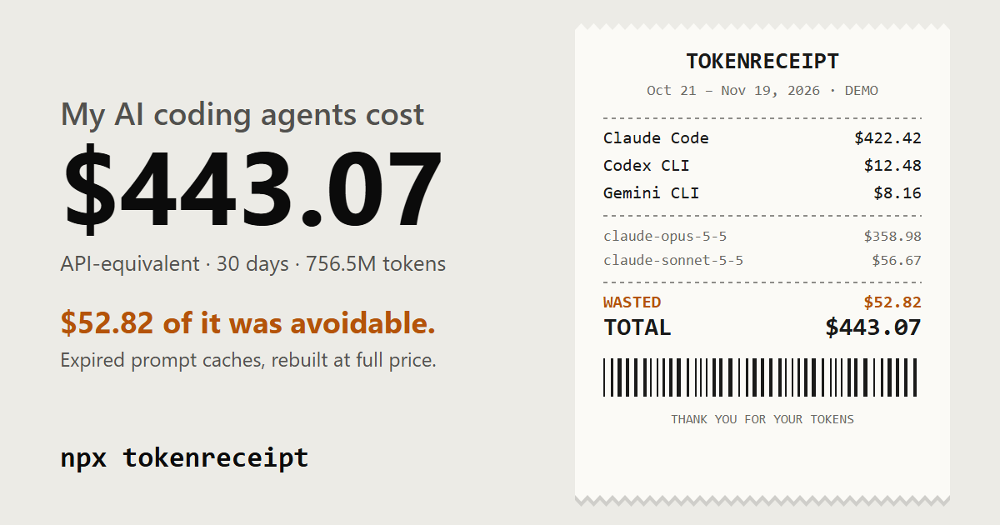
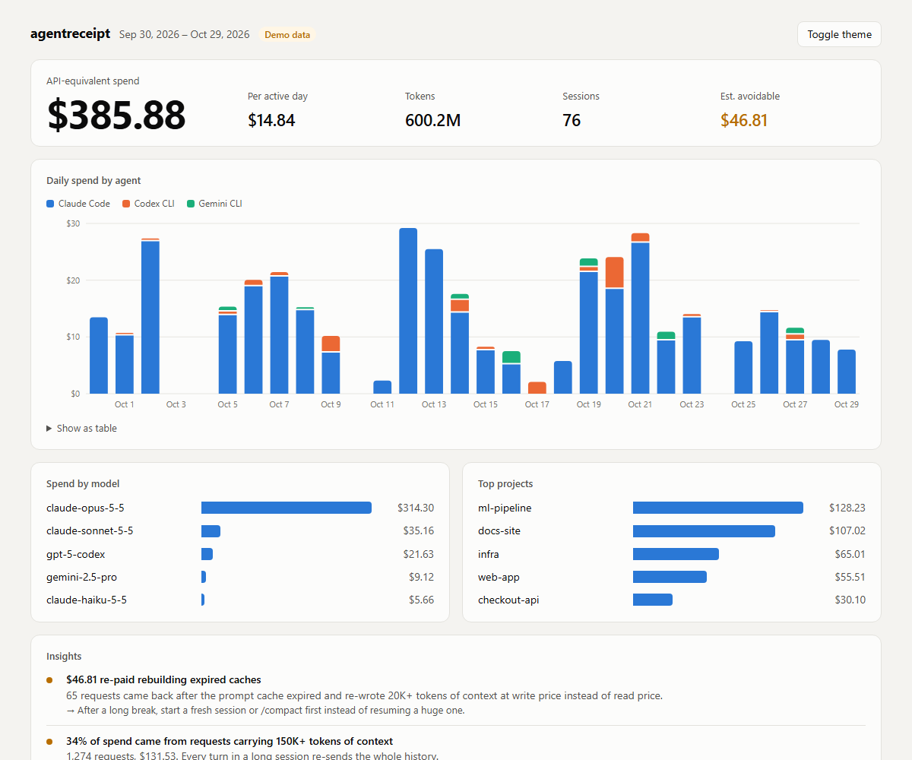

<div align="center">

# tokenreceipt

**The receipt for your AI coding agents, including the part you wasted.**
See what Claude Code, Codex CLI and Gemini CLI actually cost you, where the money went, and how much of it was avoidable.

[](https://www.npmjs.com/package/tokenreceipt)
[](https://github.com/vatsalsolanki01/tokenreceipt/actions/workflows/ci.yml)
[](https://www.npmjs.com/package/tokenreceipt)


[](LICENSE)

One command · 100% local · zero dependencies · no API keys

```bash
npx tokenreceipt
```





<details>
<summary>The <code>--html</code> dashboard</summary>

<picture>
  <source media="(prefers-color-scheme: dark)" srcset="docs/dashboard-dark.png">
  
</picture>

</details>

If tokenreceipt found money you can save, a ⭐ helps other people find it too.

</div>

---

## Contents

- [Why](#why)
- [Quick start](#quick-start)
- [What you get](#what-you-get)
- [Options and examples](#options-and-examples)
- [Insights explained](#insights-explained)
- [Supported agents](#supported-agents)
- [How it works](#how-it-works) · [Key terms](#key-terms)
- [How costs are calculated](#how-costs-are-calculated)
- [Accuracy and known limitations](#accuracy-and-known-limitations)
- [Privacy](#privacy)
- [JSON output](#json-output)
- [Environment variables, files and exit codes](#environment-variables-files-and-exit-codes)
- [FAQ](#faq)
- [Troubleshooting](#troubleshooting)
- [Roadmap](#roadmap) · [Contributing](#contributing) · [License](#license)

## Why

For many developers, coding agents have become a big AI expense, and the least visible one:

- You run **several agents** (Claude Code here, Codex there, Gemini for a second opinion), and none of them shows you the combined picture.
- On a **subscription** you never see a bill, so you can't tell how much API value you're getting or which habits burn your limits.
- On the **API**, the invoice says *how much* but not *why*: which project, which session, which model.
- A large share of agent spend is **avoidable**: prompt caches that expire while you're at lunch, sessions that drag 300K tokens of history into every turn.

Every one of these agents already writes detailed usage logs to your disk. **tokenreceipt reads them and gives you the receipt.**

## Quick start

```bash
npx tokenreceipt            # summary in your terminal
npx tokenreceipt --html     # interactive dashboard in your browser
npx tokenreceipt --demo     # no logs yet? try it with realistic fake data
```

Requirements: **Node.js 18.17+** on macOS, Linux or Windows. There's nothing to configure: it finds the logs in their default locations.

Prefer a permanent install?

```bash
npm install -g tokenreceipt
tokenreceipt --days 7
```

Updating: `npx tokenreceipt@latest` always runs the newest version; for a global install, run `npm install -g tokenreceipt@latest`. Uninstall with `npm uninstall -g tokenreceipt`.

## What you get

### Terminal summary

```
  tokenreceipt · what your AI coding agents cost (API-equivalent) [DEMO DATA]
  Oct 20, 2026 – Nov 18, 2026 · 24 active days · 79 sessions · 6,034 requests

  $429.78 total    $17.91 per active day    735.2M tokens
  ▲ $52.49 estimated avoidable (see insights)

BY AGENT
  Claude Code  ████████████████████████      $405.89  94%
  Codex CLI    █░░░░░░░░░░░░░░░░░░░░░░░       $11.95  3%
  Gemini CLI   █░░░░░░░░░░░░░░░░░░░░░░░       $11.94  3%

BY MODEL
  model              requests  input+cache  output     cost  share
  claude-opus-5-5       3,735       466.3M    3.0M  $348.90    81%
  claude-sonnet-5-5       982       117.5M  782.8K   $50.18    12%
  ...

TOP PROJECTS
  project       requests  input+cache  output    cost  share
  web-app          1,318       176.5M    1.1M  $96.50    22%
  ml-pipeline      1,390       159.5M    1.1M  $93.73    22%
  ...

LAST 14 DAYS
  Thu, Nov 05 █████████████████░░░░░░░░░░░░░     $18.01
  Fri, Nov 06 █████░░░░░░░░░░░░░░░░░░░░░░░░░      $4.99
  Sat, Nov 07 ░░░░░░░░░░░░░░░░░░░░░░░░░░░░░░      $0.00
  ...

INSIGHTS
  ● $52.49 re-paid rebuilding expired caches
    69 requests came back after the prompt cache expired and re-wrote 20K+ tokens of
    context at write price instead of read price.
    → After a long break, start a fresh session or /compact first instead of resuming
    a huge one.
  ● ~$60.26 less if light turns had run on Sonnet
    1,483 requests on Opus/Fable ($120.52, 35% of premium-model spend) produced under
    300 tokens of output: tool calls, quick edits, short answers.
    → Use a lighter model (/model sonnet) for routine edits and exploration; switch to
    Opus for planning and hard bugs.
  ● 39% of spend came from requests carrying 150K+ tokens of context
    1,680 requests, $168.49. Every turn in a long session re-sends the whole history.
    → Use /clear between unrelated tasks and /compact in long ones.
  ● Most expensive session: $15.92 in docs-site
```

*(Output from `--demo`; the fake data moves with today's date, so your numbers will differ slightly.)*

### Dashboard (`--html`)

A single self-contained HTML file. It works offline, loads nothing from the internet, and you can keep it or send it to someone.

- **Hero total** and tiles: per active day, tokens, sessions, estimated avoidable spend
- **Daily spend chart**, stacked by agent, with hover details and a "show as table" view
- **Spend by model** and **top projects**
- **Insights** with concrete tips
- **Most expensive sessions** (when, which agent, project, main model, requests, cost)
- **Share card**: a 1200×630 receipt of your month (total, per agent, top models, what was wasted). Click *Download PNG* to post it. It never shows project names.
- Light and dark themes (follows your OS, with a toggle)

### Drill-down tables (`--by`)

```
$ npx tokenreceipt --by session
  started     agent        project       main model         requests    cost
  2026-10-19  Claude Code  docs-site     claude-opus-5-5         136  $17.22
  2026-10-12  Claude Code  ml-pipeline   claude-opus-5-5         142  $17.18
  2026-10-14  Claude Code  infra         claude-opus-5-5         141  $17.02
```

Views: `day`, `model`, `project`, `session` (top 50), `agent`.

## Options and examples

| Option | Description |
|---|---|
| `--days <n>` | Only the last *n* days, today included |
| `--since <YYYY-MM-DD>` | Start date (local time) |
| `--until <YYYY-MM-DD>` | End date, inclusive |
| `--agent <list>` | Comma-separated: `claude`, `codex`, `gemini`. Default: all |
| `--by <view>` | Full table for one dimension: `day`, `model`, `project`, `session`, `agent` |
| `--html [file]` | Write the dashboard (default: a temp folder) and open it in your browser |
| `--no-open` | With `--html`: write the file but don't open it |
| `--json` | Print the full report as JSON (see [JSON output](#json-output)). With `--html`, the dashboard is also written |
| `--redact` | Replace project names with `project-1`, `project-2`… everywhere |
| `--demo` | Use built-in fake data instead of your logs |
| `--offline` | Never download the public price table (see [Privacy](#privacy)) |
| `--no-color` | Plain output. `NO_COLOR` is respected too; colors are off when piped |
| `-h`, `--help` / `-v`, `--version` | Help / version |

```bash
npx tokenreceipt --days 7                          # this week
npx tokenreceipt --since 2026-10-01 --until 2026-10-31 --by project
npx tokenreceipt --agent claude --by model         # Claude Code only, per model
npx tokenreceipt --html report.html --no-open      # write a dashboard file
npx tokenreceipt --html --redact                   # safe to screenshot and share
npx tokenreceipt --json | jq '.totals.cost'        # scripting
```

## Insights explained

| Insight | How it's detected | What to do |
|---|---|---|
| **Expired-cache rebuilds** (counts as *avoidable*) | In the same session, a request arrives after the prompt cache's lifetime (5 min or 1 h, taken from the log) and re-writes ≥20K tokens. The avoidable part is *write price − read price* for those tokens. | After a long break, `/compact` or start fresh instead of resuming a giant session. |
| **Premium model on light turns** | Opus/Fable requests whose reply was under 300 tokens (tool calls, quick edits, short answers). Shown when they are ≥10% of premium-model spend and Sonnet 5.5 would have cost ≥$1 less. The saving is compared at standard speed and is *not* added to avoidable, since some of those turns may need Opus. | `/model sonnet` for routine work; Opus for planning and hard bugs. |
| **Context bloat** | Requests that carry >150K tokens of context (input + cache). Shown when they're ≥5% of spend. | `/clear` between unrelated tasks; `/compact` long ones. |
| **Subagent share** | Spend from Claude Code subagents (sidechains). Shown when ≥3% of spend. | Point exploratory subagents at a cheaper model. |
| **Fast-mode premium** | The extra paid for fast mode versus standard speed. | Turn fast mode off for unattended runs. |
| **Web searches** | Claude's server-side web searches, billed per search. | |
| **Most expensive session** | The single costliest session, with its date and main model. | |
| **Unpriced models** | Models with no known price (cost shows as $0). | Run once with network access, or open an issue. |

"Estimated avoidable" in the header only counts cache rebuilds. It's a conservative estimate, not a promise.

## Supported agents

| Agent | Where tokenreceipt looks | What it reads |
|---|---|---|
| **Claude Code** | `~/.claude/projects/**`, `~/.config/claude/projects/**`, and every folder in `CLAUDE_CONFIG_DIR` (comma-separated) | Per-response `usage`: input, output, cache reads, 5-minute and 1-hour cache writes, fast mode, web searches, inference geography, subagents |
| **Codex CLI** | `~/.codex/sessions/**` and `~/.codex/archived_sessions/**` (or `CODEX_HOME`) | `token_count` events (cumulative totals, turned into per-request costs), model and working directory |
| **Gemini CLI** | `~/.gemini/tmp/*/chats/*.json` | Per-message `tokens` (input, cached, output, thoughts) and model |

Not yet supported: Cursor (it keeps usage in its own database and on its servers, not as token logs), OpenCode, Copilot CLI, Aider, Cline. See the [Roadmap](#roadmap). Parsers are small, and PRs are welcome.

On Windows, `~` means your user folder, e.g. `C:\Users\you\.claude\projects`.

**Projects:** a session is attributed to the folder it **started** in, even if the agent later `cd`s into subfolders. Gemini CLI only stores a hash of the folder; tokenreceipt recovers the name when the same folder appears in your Claude Code or Codex logs, and otherwise shows `gemini:<hash>`.

## How it works

```
 ~/.claude/projects/**/*.jsonl ─┐
 ~/.codex/sessions/**/*.jsonl  ─┼─▶ parse ─▶ one record per API request ─▶ price ─▶ group + detect waste ─▶ terminal / JSON / HTML
 ~/.gemini/tmp/*/chats/*.json  ─┘
```

1. **Find** log files in each agent's default folders (plus the [environment variables](#environment-variables-files-and-exit-codes)).
2. **Parse** them line by line, streaming, so even very large logs use little memory. Corrupt lines, impossible timestamps (before 2023 or in the future), implausible token counts and unreadable files are skipped, never fatal.
3. **Normalize** every API request into one record: agent, model, time, project, session, and non-overlapping token counts (uncached input, output, cache read, 5-minute and 1-hour cache write). Duplicates are removed here.
4. **Price** each record with the formula below.
5. **Aggregate** by agent, model, project, local calendar day and session, and run the insight detectors.
6. **Render** to the terminal, JSON or a self-contained HTML file.

## Key terms

| Term | Meaning |
|---|---|
| **Request** | One API call an agent made to a model. One prompt from you usually triggers many, because every tool call starts a new request. |
| **Session** | One conversation in an agent: a Claude Code session, a Codex rollout, a Gemini chat. Subagent requests count toward their parent session. |
| **Input / output tokens** | Tokens sent to and generated by the model. Thinking/reasoning tokens are billed as output. |
| **Cache read** | Input served from the provider's prompt cache. Much cheaper than normal input. |
| **Cache write** | Input stored in the prompt cache so later requests can read it. Costs more than normal input (1.25× for 5 minutes, 2× for 1 hour). |
| **API-equivalent cost** | What these tokens cost at public list prices. Not what a subscription charges you. |
| **Active day** | A calendar day (your local time zone) with at least one request. |
| **Avoidable** | Spend tokenreceipt can attribute to a fixable pattern. Currently: rebuilding prompt caches that expired. |

## How costs are calculated

For every API request:

```
cost = input × input_price
     + output × output_price             (thinking/reasoning tokens are output)
     + cache_read × cache_read_price
     + cache_write_5m × 1.25 × input_price
     + cache_write_1h × 2 × input_price
     + web_searches × $0.01
```

**Claude prices** are built in, from Anthropic's [official pricing page](https://platform.claude.com/docs/en/about-claude/pricing) (checked 2026-10-29), per million tokens:

| Model | Input | Output | Cache read |
|---|---|---|---|
| Claude Fable 5.1 | $10 | $50 | $0.25 |
| Claude Fable 5 | $10 | $50 | $1.00 |
| Claude Opus 5.5 | $4 | $20 | $0.20 |
| Claude Opus 5 / 4.8 / 4.7 / 4.6 / 4.5 | $5 | $25 | $0.50 |
| Claude Sonnet 5.5 | $2 | $10 | $0.10 |
| Claude Sonnet 5 | $2 | $10 | $0.20 |
| Claude Sonnet 4.6 / 4.5 / 4 | $3 | $15 | $0.30 |
| Claude Haiku 5.5 (prompt ≤100K / >100K) | $0.10 / $0.50 | $0.50 / $2.50 | $0.01 / $0.05 |
| Claude Haiku 4.5 | $1 | $5 | $0.10 |

Older models (Opus 4/4.1, Haiku 3.5, Claude 3.x) are included too. Pricing modifiers that tokenreceipt applies:

- **Fast mode**: 2× on Opus 5.5, Opus 5 and Opus 4.8.
- **US-only inference** (`inference_geo: "us"`): 1.1× on Claude 4.6 and later.
- **Haiku 5.5 long prompts**: the higher tier applies when input + cache tokens exceed 100K.
- Model IDs from Bedrock/Vertex (`us.anthropic.…`, `…@20251101`, `…[1m]`) are normalized to the same price.

**Other models** (OpenAI, Gemini) are priced from [LiteLLM's public price table](https://github.com/BerriAI/litellm/blob/main/model_prices_and_context_window.json), including cached-input and >200K long-context rates where listed. The table is downloaded at most once a day and cached locally.

## Accuracy and known limitations

Costs are **API-equivalent**: what the same tokens cost at public list prices. Things tokenreceipt handles that naive log-summing gets wrong:

- **Claude Code logs one line per content block**, and every line repeats the same usage. tokenreceipt counts each response once, keyed by message and request ID, and keeps the most complete copy. Naive summing over-counts by 2–3×.
- **The same session in two config folders** (e.g. `~/.claude` and a `CLAUDE_CONFIG_DIR` copy) is counted once.
- **Codex totals are cumulative**, so each request is costed from the difference, and repeated events are ignored.
- **Cache pricing**: separate 5-minute and 1-hour write prices, and model-specific read prices (0.1× input on most models, 0.05× on Opus 5.5 and Sonnet 5.5, 0.025× on Fable 5.1).

Known limitations, stated plainly:

- **Background calls Claude Code doesn't log.** Claude Code makes some small API calls (session titles, "while you were away" recaps) whose usage isn't written to the message logs, so tokenreceipt can't see them. On short sessions this can mean reading 5–20% low.
- **Claude Code's internal per-session counter can differ**, in both directions. Compared with it on the author's machine, most sessions matched closely, but individual sessions differed by up to ±20%. The internal counter isn't always updated when a session ends, and sometimes counts more than the logs contain. tokenreceipt reports exactly what the logs contain, priced at official rates.
- **Discounts aren't modelled**: Batch API, negotiated enterprise pricing, free credits, Bedrock/Vertex regional pricing.
- **Log formats change.** Agents update their log formats without notice. If your numbers look wrong, please [open an issue](../../issues/new?template=wrong-numbers.md).

## Privacy

- **Your logs never leave your machine.** tokenreceipt reads them locally and writes output only to your terminal or to the HTML file you ask for.
- **No telemetry, no accounts, no API keys.**
- **The only network request** downloads the public LiteLLM price list. It happens only when your logs contain non-Claude models, at most once a day; the list is cached under your OS cache folder. `--offline` disables it completely.
- **Zero runtime dependencies**: the published package is a ~30 kB download of plain, readable JavaScript.
- `--redact` replaces every project name and session ID in the terminal, JSON and dashboard output, so screenshots are safe to share.

## JSON output

`--json` prints the whole report, so you can pipe it into `jq`, a spreadsheet or your own dashboard:

```jsonc
{
  "from": "2026-09-30", "to": "2026-10-29",
  "totals": {
    "cost": 385.88, "tokens": 600195973,
    "input": 7992410, "output": 5728058, "cacheRead": 556010572, "cacheWrite": 30464933,
    "requests": 5298, "sessions": 76, "activeDays": 26, "spanDays": 30,
    "avoidable": 46.81
  },
  "agents": ["claude", "codex", "gemini"],
  "byAgent":   [ /* Bucket */ ],
  "byModel":   [ { "key": "claude-opus-5-5", "label": "claude-opus-5-5", "cost": 314.30,
                   "requests": 3177, "tokens": 369932570,
                   "input": 634853, "output": 3479207, "cacheRead": 344149620, "cacheWrite": 21668890,
                   "byAgent": { "claude": 314.30, "codex": 0, "gemini": 0 } } ],
  "byProject": [ /* Bucket */ ],
  "byDay":     [ /* Bucket per calendar day, key = YYYY-MM-DD, idle days included */ ],
  "sessions":  [ { "agent": "claude", "sessionId": "…", "project": "/home/dev/code/docs-site",
                   "label": "docs-site", "start": 1792392290380, "end": 1792421293978,
                   "requests": 136, "cost": 17.22, "model": "claude-opus-5-5" } ],
  "insights":  [ { "kind": "cache-rebuild", "title": "…", "detail": "…", "cost": 46.81, "tip": "…" } ],
  "unpricedModels": []
}
```

All money values are USD, token values are raw counts and timestamps are epoch milliseconds. Before 1.0, new fields may be added in any release; changes to existing fields will be called out in the release notes. `sessions` holds the 50 most expensive.

## Environment variables, files and exit codes

| Variable | Effect |
|---|---|
| `CLAUDE_CONFIG_DIR` | Extra Claude Code config folder(s), comma-separated. `~/.claude` and `~/.config/claude` are always read too. |
| `CODEX_HOME` | Codex CLI home folder (default `~/.codex`). |
| `NO_COLOR` | Disable colored output. |
| `XDG_CACHE_HOME` | Where the price-table cache goes (see below). |
| `TOKENRECEIPT_DEBUG=1` | Print every log file that was skipped, and why, to stderr. |

**Files tokenreceipt writes:**

- The **dashboard**, only with `--html`: the path you give, or `<OS temp folder>/tokenreceipt/tokenreceipt-report.html`.
- The **price-table cache**, only when non-Claude models are present and `--offline` isn't set: `$XDG_CACHE_HOME/tokenreceipt/` if that's set; otherwise `%LOCALAPPDATA%\tokenreceipt\` on Windows and `~/.cache/tokenreceipt/` elsewhere. Delete it any time.

It never modifies, moves or deletes agent logs.

**Exit codes:**

- `0`: success, including "no usage found" (with `--json`, an empty report is printed).
- `1`: invalid arguments or an unexpected error, with the message on stderr.

**Time zones:** days, `--since`, `--until` and `--days` all use your computer's local time zone.

## FAQ

**I'm on Claude Max / ChatGPT Pro. Is this what I pay?**
No. You pay your subscription. tokenreceipt shows what the same usage would cost on the API: a measure of the value you're getting, and of which habits use up your limits fastest.

**Why doesn't it match Claude Code's `/cost`?**
`/cost` covers the current session and includes a few background calls that aren't in the logs. tokenreceipt covers everything on disk. See [Accuracy](#accuracy-and-known-limitations).

**I use several Claude accounts / config folders.**
Set `CLAUDE_CONFIG_DIR` to a comma-separated list. `~/.claude` and `~/.config/claude` are always included, and duplicates are removed.

**Does it work on Windows?**
Yes. It was built and tested on Windows 11. Paths, the dashboard opener and the cache folder all handle Windows, and CI is set up to test Windows, macOS and Linux on Node 18, 20 and 22.

**Why does a model show $0?**
Its price isn't known yet. Non-Claude prices come from LiteLLM, so run once without `--offline`. If it's still $0, open an issue with the model name.

**Is the "avoidable" number real money I could have saved?**
It's an estimate of one specific, fixable pattern (expired-cache rebuilds). Real savings depend on how you change your workflow.

## Troubleshooting

| Problem | Fix |
|---|---|
| "No agent usage found" | Check that the folders in [Supported agents](#supported-agents) exist and contain recent files. Custom location? Set `CLAUDE_CONFIG_DIR` or `CODEX_HOME`. Filtering by date? Widen `--days`/`--since`. |
| Dashboard didn't open | The file path is printed. Open it manually, or pass `--html my-report.html`. |
| Weird characters in the terminal | Use a UTF-8 terminal (Windows Terminal, iTerm2, any modern Linux terminal), or add `--no-color`. |
| A log file seems to be ignored | Unreadable, locked or corrupt files are skipped so one bad file can't break the report. Set `TOKENRECEIPT_DEBUG=1` to print which files were skipped and why. |
| `--json` output is empty | With no matching usage, `--json` prints an empty report (all zeros), so scripts don't break. Check your date filters. |
| Numbers look wrong | Run `npx tokenreceipt --by model --redact` and [open an issue](../../issues/new?template=wrong-numbers.md) with the output. Please don't attach raw logs: they contain your code and prompts. |

## Roadmap

- [ ] Cursor, OpenCode, Copilot CLI, Aider, Cline
- [ ] Budgets and alerts (`--budget 200/month`, non-zero exit when exceeded)
- [ ] `--watch` live mode and a status-line snippet for Claude Code
- [ ] Month-over-month comparison ("you spent 32% less than September")
- [ ] More waste detectors (expensive model for trivial turns, repeated failing tool loops)
- [ ] Batch/enterprise discount settings

Have an idea? [Open an issue](../../issues/new).

## Contributing

Adding an agent means one parser file that returns normalized usage records. [CONTRIBUTING.md](CONTRIBUTING.md) walks through it.

```bash
git clone https://github.com/vatsalsolanki01/tokenreceipt.git && cd tokenreceipt
npm install
npm test                         # type-check + unit and end-to-end tests
node dist/src/cli.js --demo      # run your build
```

Project layout:

```
src/
  cli.ts, args.ts       entry point and argument parsing
  sources/*.ts          one parser per agent → UsageRecord[]
  pricing.ts            Claude price table, LiteLLM lookup, cost formula
  aggregate.ts          grouping, totals, insights
  render/terminal.ts    terminal output
  render/html.ts        self-contained dashboard
  demo.ts               deterministic fake data
test/                   node:test suite with fixture logs
```

## License

[MIT](LICENSE)
